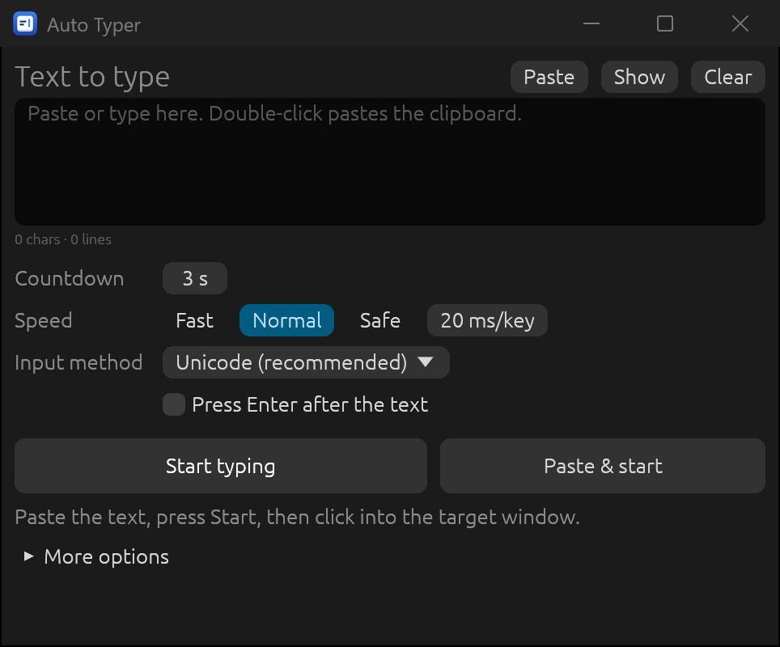

<div align="center">


# Auto Typer

**Types text for you where paste is blocked.**
Remote Desktop lock screens, CyberArk PSM sessions, VM consoles, locked-down servers.

[](https://github.com/viru185/AutoTyper/actions/workflows/ci.yml)
[](https://github.com/viru185/AutoTyper/releases/latest)
[](LICENSE)



</div>

---

Copy-paste often does not work exactly where you need it: the Windows sign-in screen of a
Remote Desktop session, a hypervisor console, a jump server with clipboard redirection turned off.
Auto Typer takes your text (usually a long generated password) and types it into the focused
window, one keystroke at a time, as if you typed it yourself.

- **Single small executable**: about 4.5 MB, no installer, no runtime, starts instantly.
- **Two input methods**: *Unicode* (works over RDP, including the lock screen) and *key presses*
  (scan codes with Shift/AltGr, for VM consoles and web gateways that ignore Unicode input).
- **Safe by design**: stops on <kbd>Esc</kbd>, when the mouse moves or when another window takes
  the focus. Refuses to type into its own window. Never saves the text.
- **Multi-line text** with masking, character/line counts, adjustable speed and countdown.
- **Type the clipboard** without opening a window: from the Start menu, PowerToys Command Palette,
  the tray icon or a global hotkey.
- **Cross-platform**: Windows (primary), Linux (X11) and macOS.

## Install

### Windows

1. Download `autotyper-windows-x86_64.exe` (or `-aarch64`) from the
   [latest release](https://github.com/viru185/AutoTyper/releases/latest).
2. Run it, open **More options** and click **Install**. Or, from a terminal:

   ```powershell
   .\autotyper-windows-x86_64.exe --install
   ```

This copies Auto Typer to `%LOCALAPPDATA%\Programs\AutoTyper` (no admin rights needed) and adds
two Start menu entries, so you can launch it from the Start menu, Windows Search,
**PowerToys Command Palette** (<kbd>Win</kbd>+<kbd>Alt</kbd>+<kbd>Space</kbd>) or PowerToys Run:

| Entry | What it does |
|---|---|
| **Auto Typer** | Opens the window. |
| **Auto Typer - Type clipboard** | Types the clipboard into the window you were using, after 2 seconds. No window. |

It also appears in *Settings → Apps → Installed apps*, where you can uninstall it
(or run `autotyper --uninstall`).

> Windows SmartScreen may warn about an unsigned download. Click *More info → Run anyway*,
> or build it yourself (see below).

### Linux

```sh
tar -xzf autotyper-linux-x86_64.tar.gz
./autotyper/autotyper --install    # ~/.local/bin + application launcher entries
```

Needs an X11 session (Wayland compositors block synthetic keyboard input) and `libxkbcommon`.

### macOS

```sh
tar -xzf autotyper-macos-universal.tar.gz
xattr -d com.apple.quarantine autotyper/autotyper   # the binary is not notarized
./autotyper/autotyper
```

On first use, allow it in *System Settings → Privacy & Security → Accessibility*.

## Usage

### The window

1. Paste the text (**Paste**, double-click the text box, or <kbd>Ctrl</kbd>+<kbd>V</kbd>).
2. Press **Start typing** (<kbd>Ctrl</kbd>+<kbd>Enter</kbd>). Or press **Paste & start**
   (<kbd>Ctrl</kbd>+<kbd>Shift</kbd>+<kbd>V</kbd>) to do both at once.
3. The window minimizes, which hands the focus back to the window you used before (for example
   the Remote Desktop session). If needed, click into the target field during the countdown.
4. Auto Typer types the text. The taskbar button shows the countdown and progress.

Press <kbd>Esc</kbd> or move the mouse to stop. After a successful run the text is cleared;
after a cancelled or failed run it stays, so you can try again.

### Type the clipboard from anywhere

Copy the password, press <kbd>Win</kbd>+<kbd>Alt</kbd>+<kbd>Space</kbd>, type
`type clip`, press <kbd>Enter</kbd>: Command Palette closes, the focus returns to your previous
window and Auto Typer types the clipboard into it two seconds later.

### Tray icon and hotkey (optional)

Under **More options**, turn on **Keep a tray icon running**. Then:

- <kbd>Ctrl</kbd>+<kbd>Alt</kbd>+<kbd>Shift</kbd>+<kbd>V</kbd> (configurable) types the clipboard
  into the focused window;
- the tray menu has *Type clipboard* and *Open Auto Typer*;
- **Start the tray icon when I sign in** starts it with Windows / your desktop session.

The tray process has no window and uses about 2 MB of private memory.

> A full-screen Remote Desktop window may capture global hotkeys. Use the windowed mode, or the
> Start menu / Command Palette entry instead.

### Command line

```text
autotyper                      open the window
autotyper --clipboard          type the clipboard into the focused window, then exit
          -d, --delay <s>      wait first (default 2)
          -m, --mode <mode>    unicode (default) or scancode
          -s, --speed <ms>     pause between keystrokes (default 20)
              --enter          press Enter after the text
autotyper --background         tray icon + global hotkey
autotyper --install            install for this user, add Start menu entries
autotyper --uninstall [--purge] [--quiet]
autotyper --help | --version
```

## Which input method?

| | Unicode (default) | Key presses (scan codes) |
|---|---|---|
| Remote Desktop, including the lock screen | ✅ | ✅ (if both keyboard layouts match) |
| VM consoles (Hyper-V, VMware, VirtualBox), KVM switches, browser-based gateways | ❌ often ignored | ✅ |
| Characters not on your keyboard layout (é, €, emoji) | ✅ | falls back to Unicode |
| Different keyboard layout on the remote machine | ✅ | ❌ wrong characters |
| Caps Lock on | ✅ | ✅ (temporarily switched off) |

If a target misses or garbles characters, slow down (**Safe** = 60 ms per key) or switch the
input method.

## Troubleshooting

- **"The focused window runs as administrator"**: Windows does not let normal apps type into
  elevated windows. Run Auto Typer as administrator for those.
- **Nothing is typed into the Remote Desktop sign-in screen**: click into the password field
  during the countdown; some sessions need a click to wake up first.
- **Wrong characters**: the remote keyboard layout differs from yours. Use Unicode mode.
- **Typing stops on its own**: it stops when the mouse moves or another window takes the focus.
  Both can be turned off under **More options**.

## Privacy

- The text is kept in memory only while needed, cleared after a successful run, and wiped from
  memory when the app exits. It is never written to disk, logged or sent anywhere.
- Settings (countdown, speed, ...) are stored in `%APPDATA%\AutoTyper\settings.toml`,
  `~/.config/autotyper/settings.toml` or `~/Library/Application Support/AutoTyper/settings.toml`.
- Auto Typer makes no network connections.

## Build from source

Requirements: [Rust](https://rustup.rs) (stable). On Windows, the
[Visual Studio Build Tools](https://visualstudio.microsoft.com/visual-cpp-build-tools/) with the
*Desktop development with C++* workload. On Linux, `libxkbcommon-dev`.

```sh
git clone https://github.com/viru185/AutoTyper
cd AutoTyper
cargo build --release        # target/release/autotyper(.exe)
cargo test
```

`cargo build --release --no-default-features` builds without the tray/hotkey support.

### Project layout

```text
src/
  main.rs            entry point: hands the arguments to lib.rs
  lib.rs             command dispatch
  cli.rs             argument parsing and --help
  app.rs             the window (egui)
  agent.rs           tray icon + global hotkey (--background)
  typing/            the typing engine
    mod.rs           countdown, keystroke loop, abort checks
    plan.rs          key press vs Unicode, per character (pure, unit tested)
    windows.rs       Windows backend (SendInput)
    enigo_backend.rs macOS / Linux backend
  clipboard.rs       type-the-clipboard
  install/           per-user install, Start menu / launcher entries
  autostart.rs       start with Windows / at login
  instance.rs        single instance + messages between instances
  settings.rs        settings file
  text.rs            text → keystrokes
build.rs             embeds the icon, version info and Windows manifest
```

## Contributing

Issues and pull requests are welcome. See [CONTRIBUTING.md](CONTRIBUTING.md).

## License

[MIT](LICENSE)
